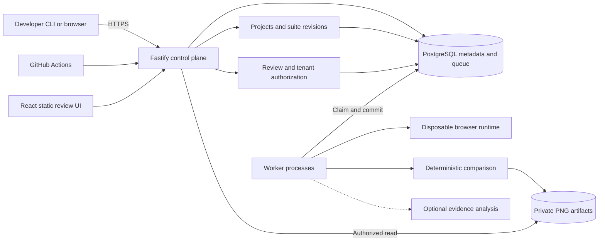
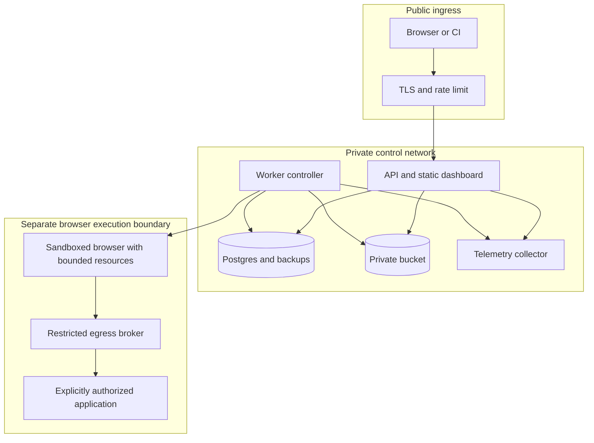
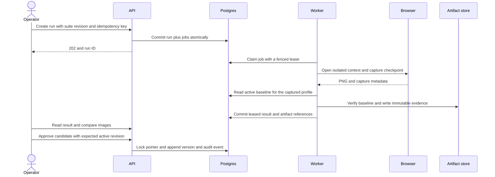
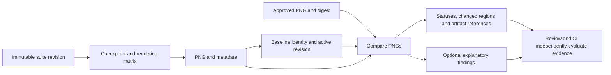
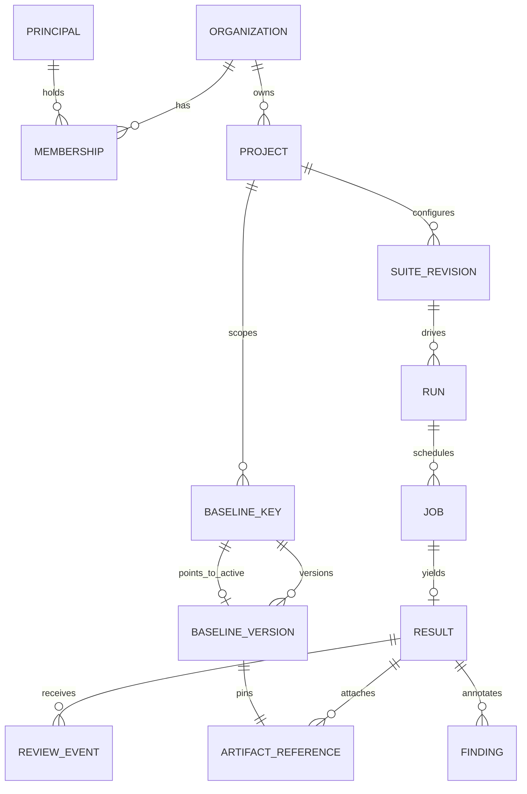
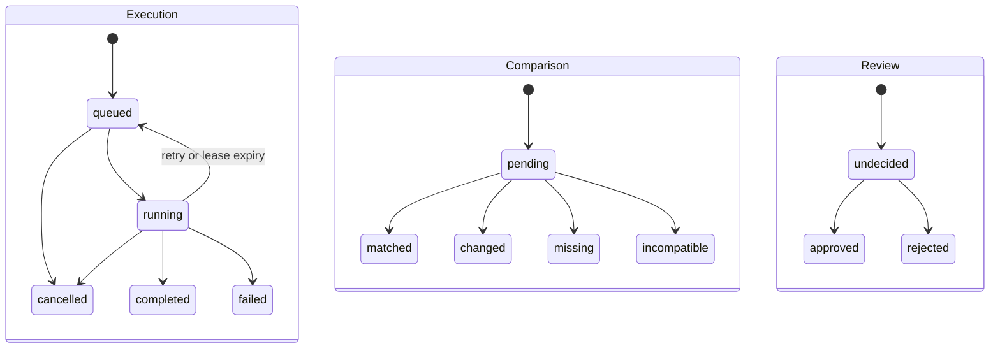
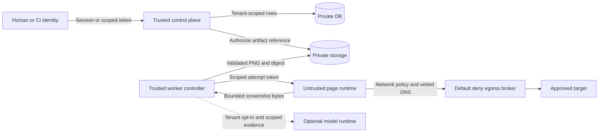

# Architecture

The control plane is a modular monolith. A separate worker process owns capture and comparison. A disposable browser profile exists per job. Initial local execution is limited to a trusted fixture and development operator. The hosted topology extends the same job and storage contracts.

## Components and deployment

## Execution and data flow

## Entity relationships

PostgreSQL owns tenants, configurations, identities, run transitions, reviewer decisions and artifact metadata. Immutable objects own PNG bytes and are addressed by SHA-256 under tenant scope. Queue state cannot alter comparison state. Baseline keys include project-scoped stable checkpoint ID, environment, canonical capture options and fixture revision, viewport, scale, locale, timezone, browser build, and rendering image. Compare against a baseline snapshot and reference that version in the result for reproducibility. Review uses the observed active version as the expected value for compare-and-swap and appends an audit event. Rollback repoints to a historical approved version while recording a new review action.

## State transitions

## Failure handling

- Idempotency keys are scoped to project and actor with a request digest. Reuse with different input returns conflict. A DB transaction covers run and queued work creation. Workers lease jobs with a fencing value and reject stale completions.
- Transient browser and store failures retry after bounded backoff. Invalid configurations and permanent capture errors terminate the attempt. A cancel request prevents new claims and blocks committing normal results once the worker acknowledges cancellation.
- Artifact writes precede metadata commits. A partial upload or lost lease can leave orphan bytes. Retry by digest and sweep unreferenced objects only after the maximum attempt window and backup-safe grace period.
- On AI outage, record analysis availability and keep deterministic evidence readable. On storage outage, emit an execution error with no comparison claim. Run state aggregates all jobs including partial failures.

## Trust boundaries

Production egress validates HTTPS destinations on redirects, resolves and verifies IPs at connection time, and blocks internal and cloud metadata networks. The browser cannot reach the control plane, object store, or database. Use disposable sandboxed processes with process, memory, time and file limits. Browser context routing is development defense in depth. OIDC identity maps to tenant-scoped membership. Require review permissions, private artifacts, redacted logs, and network isolation before connecting external targets.
